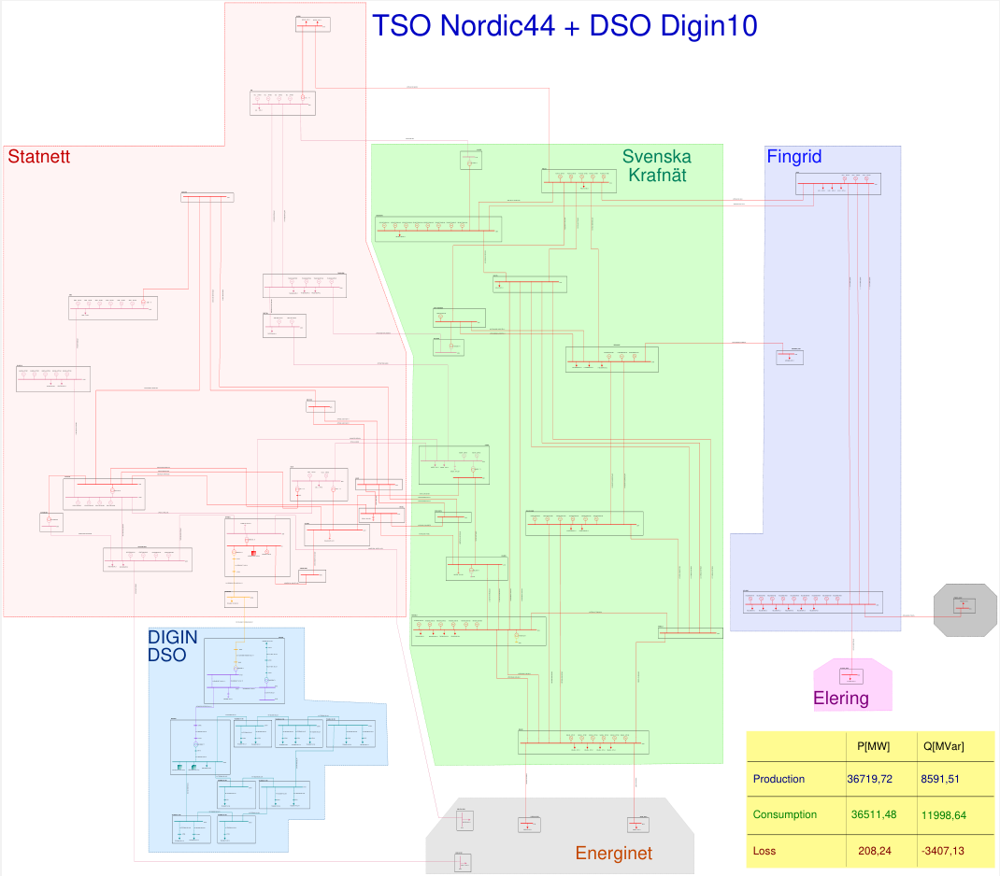

= Datasets
:idprefix:
:idseparator: -

The project considers the following datasets for testing and experimentation:

* NO Nordic44: NO and transborder resources with SE, FI; including Assets
* NO Telemark-120: NO; including Obstacles to Aviation, Assets, some Timeseries
* SE Svedala: SE
* EU ENTSO-E Conformance datasets. `ENTSO-E_Test_Configurations_v3.0.2`
* https://github.com/entsoe-tso/relicapgrid[ENTSO-E ReliCapGrid]. Extension of the ENTSO-E datasets: Reliability + Capacity is a collection of test models using CGMES and Network Code CIM profiles. Maybe is in a private Github repo, but I have access (and issue posting/triage rights)
* NO Statnett confidential datasets (not publically available, ultimate target

https://github.com/Sveino/Inst4CIM-KG/tree/develop/rdf-improved#sample-instance-data[Inst4CIM-KG/rdf-improved] section Sample Instance Data discusses the size of Nordic44, ENTSO-E, and a "multiplied" dataset with 94M triples.

== Dataset Diagram

Here is a diagram of Nordic44, Telemark-120 (DIGIN10), Svedala SE, and a couple more TSO datasets (Fingrid FI, Energinet DK, Elering):

You can zoom in until individual power system resource names are visible using this file: link:img/IPS-Nordic44-DIGIN10.pdf[img/IPS-Nordic44-DIGIN10.pdf]

== Nordic44

Nordic44 is a simplified model of the NO grid. It is aligned with market information.

There are 2 repos:

* new: https://github.com/statnett/Nordic44
* old: https://github.com/Sveino/Nordic44

Publication:

* L. Vanfretti, S.H. Olsen, V.S. Narasimham Arava, G. Laera, A. Bidadfar, T. Rabuzin, S. H. Jakobsen, J. Lavenius, M. Baudette and F.J. Gómez-López, An Open Data Repository and a Data Processing Software Toolset of an Equivalent Nordic Grid Model Matched to Historical Electricity Market Data. Data in Brief (Elsevier), February 17 2017. DOI http://dx.doi.org/10.1016/j.dib.2017.02.021[10.1016/j.dib.2017.02.021]

Issues related to Demo1:

* https://github.com/Sveino/Nordic44/issues/15 Migrate from old to new repo
* https://github.com/statnett/Nordic44/issues/1 populate Nordic44 data
** https://github.com/statnett/Nordic44/issues/18 Add missing N44-ENT file
** https://github.com/statnett/Nordic44/issues/14 Update NCP and Asset
* https://github.com/statnett/Nordic44/issues/16 add Analog measurements
* https://github.com/statnett/Nordic44/issues/8 provide all term definitions or migrate to CIM/CGMES/NC terms
** https://github.com/statnett/Nordic44/issues/5 migrate pti: props to CGMES or NC props
* https://github.com/statnett/Nordic44/issues/2 convert subgeographic regions to nc:BiddingZone
* https://github.com/statnett/Nordic44/issues/6 add mRID (GUID) from IdentifiedObject URLs

== Telemark-120

https://github.com/3lbits/CIM4NoUtility/tree/develop/Telemark-120[Telemark-120] (formerly CIM4NoUtility and DIGIN10 Grunnprofil) is another dataset of the NO grid that includes extra info, eg aviation obstacles. It is described in page https://github.com/statnett/Talk2PowerSystem/wiki/Dataset-Telemark-120[Dataset Telemark-120]

Task to describe it: https://github.com/statnett/Talk2PowerSystem_PM/issues/56

* From a brief look, its RDF data seems better structured than Nordic44. Eg instance URIs are URNs so don't need BASE.
* Available in CIM XML and JSON-LD, but lacks named graphs.

== Svedala

Svedala is a SE dataset aimed to test power flow. It is much bigger than Nordic44. Svenska Kraftnat would be very happy if we use Svedala for experimentation.

== Assets and CIM4Enterprise

* https://github.com/statnett/Nordic44/tree/main/instances/Enterprise/cimxml[Nordic44/Enterprise] now includes sample data about AssetCatalog (switches by Schneider Electric and Siemens Energy) and AssetManagement (Statnett lifecycle information about these switches)
* The ontologies are in https://github.com/statnett/CIM4Enterprise/tree/main/profile/merge-owl[statnett/CIM4Enterprise] but use older namespace versions than the data (see https://github.com/statnett/Nordic44/issues/35)
* https://github.com/Sveino/AssetCatalog[Sveino/AssetCatalog] has asset info from DIGIN about `BundledCable Bushing CircuitBreaker DSOTransformerSpecification Disconnector LoadBreakSwitch ManufacturerTransfomerShipment`. It includes XML schemas not RDFS ontologies

'''

Adapted from the Talk2PowerSystem wiki, page Datasets (https://github.com/statnett/Talk2PowerSystem/wiki/Datasets).
