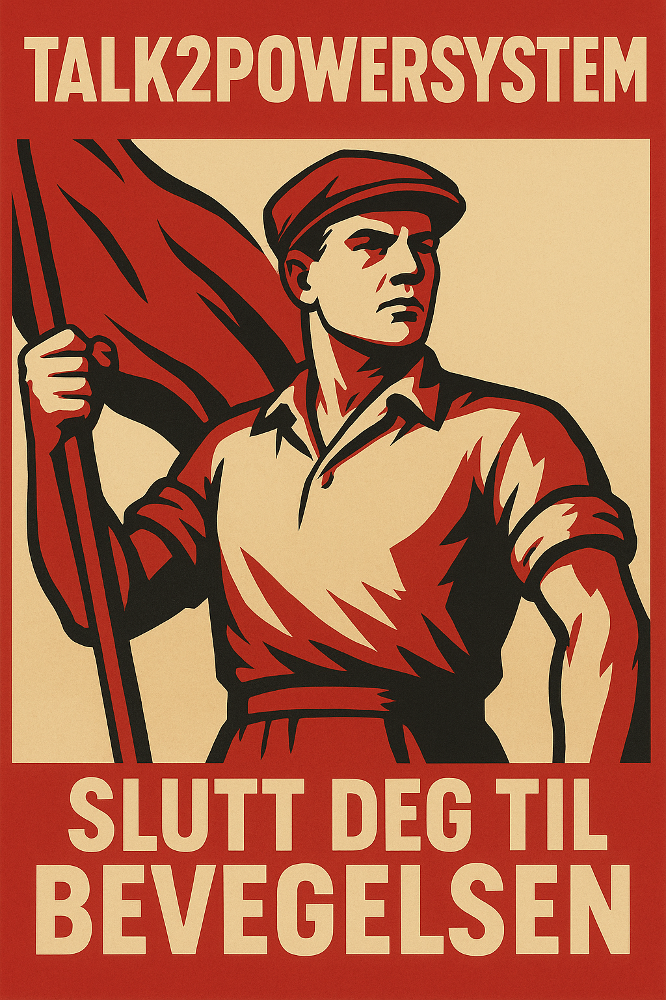
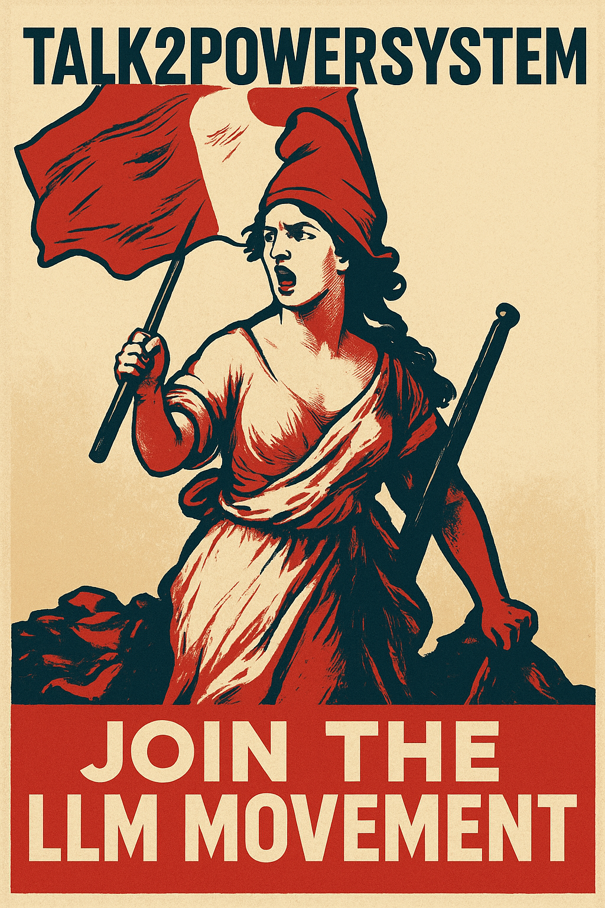
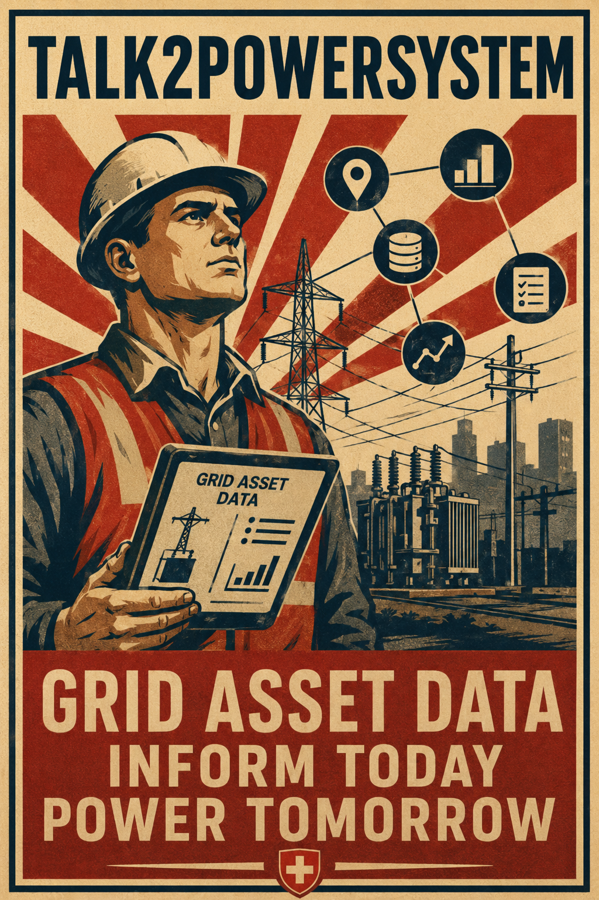
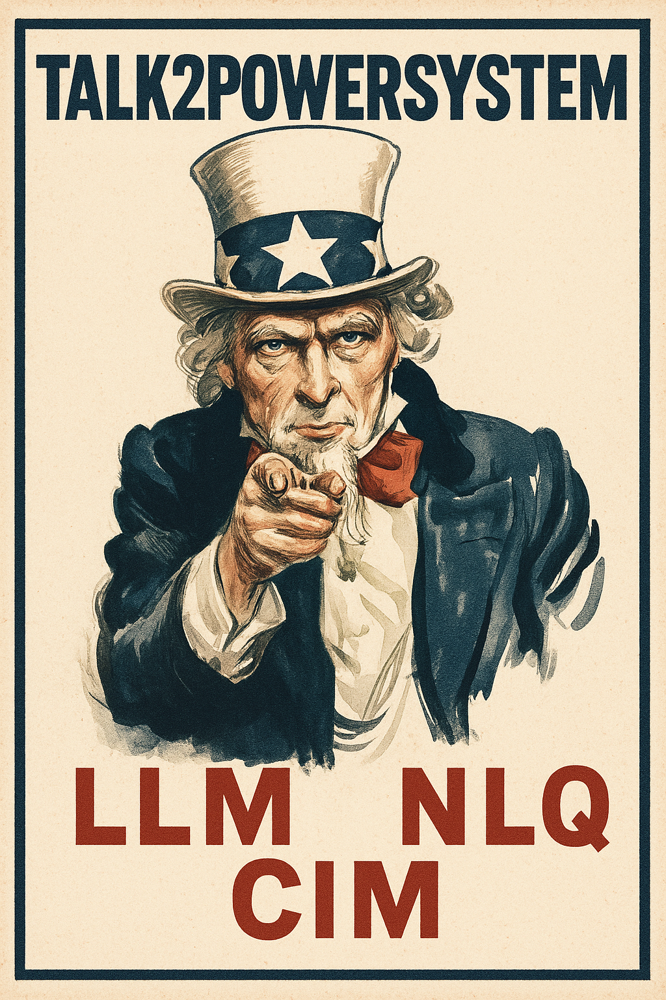
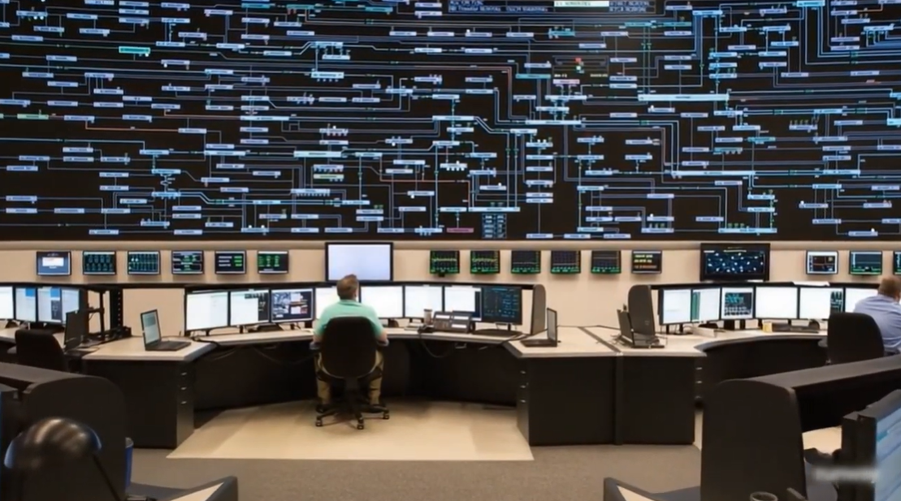
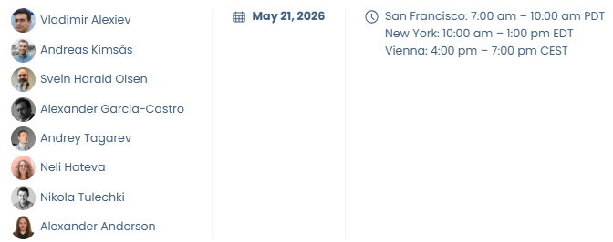

= Dissemination
:idprefix:
:idseparator: -

NOTE: This page links to files on the Ontotext Google Drive. These links are temporary and will be replaced.

Current status: Apr 2026

== Introduction

This document describes the Dissemination, Communication, Exploitation and Sustainability aspects of the project. They are important to ensure the impact and sustainability of the development efforts.

* *Dissemination*: write joint research papers, attend scientific conferences
* *Communication*: write blog posts, attend trade events
* *Exploitation*: work with Statnett application owners and end-users to make the project results more usable and reusable in day-to-day work
* *Sustainability and Proliferation*: work with other electrical enterprises to attract them for joint exploitation and development
* *Research Proposals*: research appropriate funding calls, build appropriate consortia, write research proposals.
** Also work towards securing GPU funding for joint training/fine-tuning of an electrical-CIM specific LLM.

This is a living document that will evolve with the project. It tracks ideas and actions, organized around a Timeline of monthly activities:

* *Actual*: We provide as much information as possible (links to call for papers, presentation, recording, etc)
* *Planned*: Clearly marked TODO; the timing of future activities can change multiple times

https://github.com/statnett/Talk2PowerSystem_PM/wiki/Exploitation[Exploitation and Sustainability] are covered in a separate confidential document.

=== Call for Collaboration

Statnett and Graphwise are looking for collaboration with other electrical enterprises! We can adapt the CIMon chatbot for your needs, and develop it further together by expanding the Q&A dataset, adding more tools, and training it on more electrical ontologies.

   

=== Project Materials

* https://graphwise.ai/semantic-digital-twins/[Graphwise: Semantic Digital Twins Use Case]
* https://cim.ontotext.com/chat/[CIMon Chatbot]: ask your own questions. See technical details in the "Components" page
* https://graphwise.ai/demo-area/talk-to-power-system/[Talk2PowerSystem Promo Video]: explanation/motivation video
* link:https://drive.google.com/open?id=18qvktsA4cBH-KImieIsVVgdfxJwkJxpz&usp=drive_fs[CIMon Demo Video,role=ontotext-drive]: actual interaction with the bot (with subtitles)
* https://cim.ontotext.com/graphdb/?repositoryId=cim[CIM GraphDB repository] (semantic database) with public data (Nordic44 for TSO and Telemark120 for DSO)
* https://github.com/statnett/Talk2PowerSystem/wiki/[Talk2PowerSystem Project wiki] including:
** https://github.com/statnett/Talk2PowerSystem/wiki/Related-Repositories[Repositories related to the project]
** https://github.com/statnett/Talk2PowerSystem/wiki/KGQA-Corpus-Generation[KGQA Corpus Generation]
** https://github.com/statnett/Talk2PowerSystem/wiki/Evaluation-Results[Evaluation Results]

== Dissemination

Scientific contributions:

* Vladimir Alexiev, Aleksis Datseris, Neli Hateva, Andreas Kimsas, Svein Harald Olsen, Andrey Tagarev, Nikola Tulechki. CIMon (Talk2PowerSystem): Democratizing Power System Analytics via Generative AI. Draft (work in progress), Apr 2026.
* Arkadiusz Chadzynski, Svein Harald Olsen. CIM-sala-BIM: Aligning High-Voltage Electrical CIM with bSDD for Interoperable BIM Workflows., Draft (work in progress), Apr 2026.

== Communication

Participation in events, and blog posts about the project (we planned quarterly posts, but the frequency is significantly greater).

* TODO: Post more blogs from the series on GraphDB TTYG by Graphwise partners
* TODO: Present at Siemens Energy "Data over Data" webinar

=== Mar 2025

* https://graphwise.ai/news/graphwise-statnett-project-kicks-off/[Project kickoff Blogpost]. Graphwise website, 19 Mar 2025. https://www.linkedin.com/posts/valexiev_graphwise-statnett-llm-project-kicks-off-activity-7308401426005655553-1Ply[LinkedIn 1], https://www.linkedin.com/feed/update/urn:li:activity:7308221425729863680/[LinkedIn 2], https://x.com/valexiev1/status/1902631624233156842[Twitter]
* link:https://docs.google.com/presentation/d/1I6qqQXYvZQlxsUe3rcMV589a4bXV5JWn["Advanced Analytics: Enhancing real-time decisions making in Power
Systems operation, through advanced data-driven insights algorithms to
improve better precision and efficiency",role=ontotext-drive]. Svein Olsen. SmartGrid Technical Forum (SGT25). The Hague, Netherlands, 18-20 Mar 2025. Statnett presented the project.
* EDF's RDF Community Workshop. Nikola Tulechki. EDF, Paris, 27 Mar 2025. Graphwise attended this whole-day workshop and presented the project, with a view of attracting EDF as a collaborator.

=== Apr 2025

* link:https://docs.google.com/presentation/d/1VX6ea3uqqj7jint_H7dBcJrYWqyqBio4-RVam4tozEY/edit[Statnett-LLM project: Talk2PowerSystem,role=ontotext-drive]. Vladimir Alexiev and Neli Hateva. Graphwise LastFriday meeting, 25 Apr 2025
** Abstract: Electricity is one of the early domains to use semantic technologies (starting in the 1990s). The IEC electrical CIM and ENTSO-E CGMES are comprehensive UML models of the electrical enterprise, from which RDFS/OWL ontologies and SHACL shapes are derived. They are the foundation of managing the electrical grid (Transmission System Operators), distribution (Distribution System Operators) and markets. Statnett is the Norwegian TSO and a leader in applying and extending CIM/CGMES. They have been using GraphDB (and we have been working on electricity) for about 5 years. The Talk2PowerSystem project aims to "democratise power system analytics" by enabling Natural Language Querying (NLQ) over electrical KGs through SPARQL (and later GraphQL) generation, and related use cases such as integration with their enterprise systems, time-series processing, code generation for power system analytics libraries, etc. We are creating a comprehensive Q&A dataset for electricity, and will likely store it in RDF (e.g. by extending the QADO ontology). We are currently working with OpenAI models, but also plan to work with local LLMs, and perhaps train an Electricity-specific model. The project started in Feb 2025 and will continue until Mar 2026. Significant dissemination is planned (blogs but also research papers). We hope to continue it with large-scale EU funded projects, and extend it in other electrical enterprises, such as the Swedish TSO and EDF (largest French producer).

=== May 2025

* 4 slides from the above presentation were presented by Graphwise president Atanas Kiryakov at the link:https://docs.google.com/presentation/d/1HjuO77pSiz2NhNjVA01Iit092d3Ex9GZ4QGASFp0ZlY/edit?slide=id.g3501ef98cd1_0_70#slide=id.g3501ef98cd1_0_70[Knowledge Graph Conference 2025,role=ontotext-drive] (New York) and link:https://docs.google.com/presentation/d/1q2_XnHY88tw0nYIQ9d4M7CUueu3ESegbNEWjEL6npIo/edit?slide=id.g304fb1da37f_0_134#slide=id.g304fb1da37f_0_134[Data Summit Boston 2025,role=ontotext-drive]
* https://graphwise.ai/blog/supercharge-enterprise-genai-applications-with-ttyg-2-0/[Supercharge Enterprise GenAI Applications with TTYG 2.0] by Graphwise partner Zenia Graph.
* https://graphwise.ai/blog/how-talk-to-your-graph-transforms-ai-powered-knowledge-retrieval/[How Talk-To-Your-Graph Transforms AI-Powered Knowledge Retrieval]: about Enterprise Knowledge’s collaborative experience with GraphDB and its Talk to Your Graph interface. 27 May 2025
* https://www.linkedin.com/posts/valexiev_cim-cgmes-activity-7328810157604229121-yOFM[LinkedIn Post] about ontology cleanup work:
** As part of "Talk2PowerSystem" project of Statnett SF, we at Graphwise are giving the ENTSO-E/IEC (International Electrotechnical Commission) electrical #CIM and #CGMES ontologies some very deep clean & wash.
** See https://github.com/statnett/Nordic44/issues , https://github.com/sveino/Inst4CIM-KG/issues for details.

=== Jun 2025

* Presentation at CIM IEC TC57 meeting, EDF R&D, Paris-Saclay, 6 June 2025. Vladimir Alexiev and Svein Harald Olsen. link:https://docs.google.com/presentation/d/1HjuO77pSiz2NhNjVA01Iit092d3Ex9GZ4QGASFp0ZlY/edit[Talk2PowerSystem: Democratizing power system analytics,role=ontotext-drive].
* https://github.com/statnett/Talk2PowerSystem/wiki/Blog-Ontology-Simplification-for-LLM[Blog: Ontology Simplification for LLM]. Vladimir Alexiev.
* https://graphwise.ai/practical-approach-to-leveraging-iot-data-energy-sector/[Practical Approach to Leveraging IoT Data in Energy Sector]: shares insights from Tietoevry’s collaborative experience with GraphDB and its Talk to Your Graph interface provided by Graphwise. 20 June 2025
* https://github.com/statnett/Talk2PowerSystem/wiki/Blog-Using-Semantic-Reasoning-to-Help-LLM-with-SPARQL-Generation-in-Electrical-CIM[Blog: Using Semantic Reasoning to Help LLM with SPARQL Generation in Electrical CIM]
* The Graphwise Last Friday webinar on 27 June 2025 presented 3 aspects of the project to the whole company, with a potential audience of over 200 people:
** Q&A generation for NLQ evaluation
** Ontology Simplification for Easier NLQ
** Using Semantic Reasoning to Help LLM with SPARQL Generation in Electrical CIM
* link:https://drive.google.com/file/d/1ESudm23i6h4zOLPUBIoj11GzPdMQ75J1/view[Project presentation at CORESO,role=ontotext-drive]. Svein Olsen, 26 June 2026. 28 slides. There are 2 major RCCs that may be interested to join the project

=== Jul 2025

* https://github.com/statnett/Talk2PowerSystem/wiki/Blog-Trying-ChatGPT-for-Electrical-CIM-Data-Validation[Blog: Trying ChatGPT for Electrical CIM Data Validation]. Vladimir Alexiev, Jul 2025

=== Aug 2025

* Mid-term Project Public Webinars. Below are links to presentations, and we’re working on publishing the recordings and transcripts as well.
** link:https://drive.google.com/file/d/1MJvHWVRvSYKkepudh9Eh2uHAiG661naY/view[IEC CIM Fundamentals,role=ontotext-drive]. Svein Olsen. Oslo, Norway, 21 Aug 2025. 66 slides. link:https://drive.google.com/open?id=1gKLqgz77i-oZEwfmOAK_zlo6Nn1bLvlH[Recording,role=ontotext-drive]
** link:https://docs.google.com/presentation/d/1UmLg_3GXuTtUw1hGMiUJ1_EJP9MLu2zOHeCO8Di7Ukc/edit[Knowledge Graph and LLM Fundamentals,role=ontotext-drive]. Arkadiusz Chadzynsky, Vladimir Alexiev, Helmut Nagy. Manchester, Sofia, Vienna, 21 Aug 2025. 74 slides. link:https://drive.google.com/open?id=19GWW8lbu-KjMFHGAgpzn-pEZqsW3oYJ5[Recording,role=ontotext-drive]
** link:https://docs.google.com/presentation/d/1vk1yMV4CZfip0dKOFxKZbtlaxgAZ_WCIhj9_gkGHleo/edit[Talk2PowerSystem Executive Summary,role=ontotext-drive]. Andreas Kimsas. Oslo, Norway, 25 Aug 2025. 14 slides. link:https://drive.google.com/open?id=1vXM5qy4k6e7AawjhZEUpThVD8TfTALfg[Recording,role=ontotext-drive]
** link:https://docs.google.com/presentation/d/1b5tH1rLoiTrKaZ2BrSIEO-7a71nr4CWb1HO49A3jtTI/edit[Talk2PowerSystem Detailed Project Presentation,role=ontotext-drive]. Vladimir Alexiev, Andrey Tagarev, Nikola Tulechki, Arkadiusz Chadzynski. Sofia, Bulgaria, 21 Aug 2025. 100 slides. link:https://drive.google.com/open?id=1EKLWpEPPqw7WHTs7mLfQDxWvl2sLu9xQ[Recording,role=ontotext-drive]
* https://graphwise.ai/blog/efficient-discovery-of-identifiers-with-the-autocomplete-tool-in-graphwise-graphdb/[Efficient Discovery of Identifiers with the Autocomplete Tool in Graphwise GraphDB]. Graphwise blog post. Andrey Tagarev, 29 Aug 2025. This tool was pioneered by the Talk2PowerSystem project and is now part of GraphDB’s "Talk to Your Graph" toolbox.
* https://www.europower.no/digitalisering/tilpasser-kraftsystemdata-for-a-kunne-bruke-naturlig-sprak-i-ki-agentene/2-1-1865369[Tilpasser kraftsystemdata for å kunne bruke naturlig språk i KI-agentene]. Europower.no interview, Andreas Kimsas. 30 Aug 2025. This is a Norwegian newspaper for the power industry, and most companies in the industry subscribe to it. It helps to raise awareness about the project to other Norwegian companies.

=== Sep 2025

* https://graphwise.ai/blog/the-power-of-model-context-protocol-using-natural-language-to-query-graphdb/[The Power of Model Context Protocol: Using Natural Language to Query GraphDB]. Sava Savov. Graphwise blogpost, 4 Sep 2025

=== Oct 2025

* link:https://docs.google.com/presentation/d/1ktXSCo3akYUnZH2ZKGs8CfpmnMWYtnui[Talk2PowerSystem presentation,role=ontotext-drive] at https://nfea.no/arrangementer/digitalization-in-the-automation-domain-2025/[Digitization in the Automation Domain]. Svein Olsen. Oslo, Norway, 22-23 Oct 2025.
* link:https://drive.google.com/open?id=1rrd53d9tnDKiVxW6q_fyDrVX9NumX_Ec&usp[Talk2PowerSystem: Power System data to the people,role=ontotext-drive]. Machine Learning Forum (ML-Forum). Olav Westeng Alstad and Andreas Kimsas, Trondheim, Norway, 22 Oct 2025.
* https://github.com/statnett/Talk2PowerSystem/wiki/Blog-Using-Double-Optional-to-Select-Preferred-Value-in-SPARQL[Blog: Using Double Optional to Select Preferred Value in SPARQL]. Vladimir Alexiev, 29 Oct 2025
* Presented at NorwAI initiative (Statnett is a member: its representative is from the Data Science department. Contact: Till Lech from SINTEF (NorwAI innovation manager)

=== Nov 2025

* https://github.com/statnett/Talk2PowerSystem/wiki/Blog-Mapping-Electrical-Resources-with-GeoSPARQL[Blog: Mapping Electrical Resources with GeoSPARQL]. Nikola Tulechki, 7 Nov 2025

=== Feb 2026

* Demo of CIMon chatbot, https://www.act.nato.int/activities/innovation-continuum/[NATO Innovation Continuum] Spark event. Nikola Tulechki. GATE Big Data Institute (Sofia), 24 Feb 2026. Generated organic interest with 100 defence IT people because the chatbot works on critical infrastructure data, and because of the complexity of the data.

=== Mar 2026

* link:https://drive.google.com/file/d/14_ki2koPHQJdWrfQHQp6aEM3ShvkfbpC/view[Talk2PowerSystem: democratizing the use of power system models,role=ontotext-drive]: How Statnett can use natural language in AI agents. Andreas Kimsas. https://ki.europower.no/[The Power Industry AI Conference] (in Norwegian). 17 March 2026, Vulkan Arena, Oslo
* link:https://docs.google.com/presentation/d/1NyC7Q7gflezKSJbeobbVwdHf6g1xOsc6[Implementing Large Language Models to Empower Operators to Understand
Complex Scenarios and Make Trusted Decisions,role=ontotext-drive]: Talk2PowerSystem: Knowledge Graph + CIM: Enabling Explainable Grid Intelligence. https://smartgrid-forums.com/[Smart Grid Technical Forum]. 25 March 2026. Svein Olsen.
* link:https://drive.google.com/file/d/1iVafDTKyv5eFcPRIzMUJ_6XWKFxdRDqd/view[Talk to Power System promotion video,role=ontotext-drive]. Innovation showcase: Semantic Digital Twins. Graphwise Marketing, 20 Mar 2026

=== Apr 2026

* https://graphwise.ai/blog/advancing-power-system-analysis-with-ai-and-semantic-data/[Advancing Power System Analysis with AI and Semantic Data]. Vladimir Alexiev, Nikola Tulechki. Graphwise blog post, April 27, 2026. Main takeaways:
** Natural language replaces complex manual SPARQL queries
** Simplified ontologies make LLMs significantly more accurate
** Semantic shortcuts collapse deep data hierarchies reliably
** GeoSPARQL adds spatial context and map-based visualization
* link:https://docs.google.com/presentation/d/1FtfFdgcvEjxaVyirl8nPb3AUBuPirshI/edit[From Data Models to Knowledge Systems: Reasoning and Versioning in CIM,role=ontotext-drive]. Svein Harald Olsen and Vladimir Alexiev. https://ucaiug.org/past-ucaiug-events/cimug-cologne-germany-2026/[CIM User Group meeting] Germany (CIMug). 30 Apr 2026, Cologne, Germany

=== May 2026

https://graphwise.ai/event/talk2powersystem-democratizing-power-system-analytics-via-generative-ai/[Talk2PowerSystem: Democratizing Power System Analytics via Generative AI]: Talk2PowerSystem final project webinar (CIMon results). Live Demo. Expert Panel with PNNL & Siemens Energy. 21 May 2026, online (and available on demand).

Speaker lineup:

Final Webinar:

* link:https://docs.google.com/presentation/d/1wPPvjVB_GWS5OrFHVAdU7U4AU26N-rLFxvOWYnunUbA?usp=drive_fs["Talk2PowerSystem Project Introduction, CIM, Knowledge Graphs & LLMs",role=ontotext-drive]. Andreas Kimsås, Svein Harald Olsen, Vladimir Alexiev
* link:https://drive.google.com/open?id=18qvktsA4cBH-KImieIsVVgdfxJwkJxpz&usp=drive_fs[CIMon Demo Video,role=ontotext-drive]. Nikola Tulechki
* link:https://docs.google.com/presentation/d/1rQ36hlN-N43hRqquaVrG3Wlf0AVeDIVTQcy02tA1m08?usp=drive_fs[Talk2PowerSystem Technical Deep Dive,role=ontotext-drive]. Can LLMs answer complex power system questions? Vladimir Alexiev, Neli Hateva, Andrey Tagarev.
* link:https://drive.google.com/file/d/1856fsrS2voFZ9q8nj9wD-2i4hunNdqlI/view?usp=sharing[CIM-based Data Agents for Interoperability,role=ontotext-drive]. Enabling Control Room AI Applications with CIM and Graph Databases. Alexander Anderson, PNNL
* From FAIR to Enterprise Knowledge Graphs over a Data Mesh. Alexander Garcia-Castro, Siemens Energy (presentation and recording are not available yet)
* link:https://docs.google.com/document/d/1aVrPGbxD9fJNHu1pF7-1usOZIgCQ943rg2LhAD8DmMg/edit?usp=sharing[Talk2PowerSystem Final Webinar Q&A Session,role=ontotext-drive]
* https://graphwise.ai/event/talk2powersystem-democratizing-power-system-analytics-via-generative-ai/[Talk2PowerSystem Final Webinar Recording]: available on demand after registration

Background materials:

* https://www.pnnl.gov/main/publications/external/technical_reports/PNNL-38003.pdf[Connecting Minds: AI Use Cases to Bridge Power Systems and Large Language Models for Practical Applications] (PNNL-38003, May 2025): Compilation of 20 high-impact use cases of LLMs for planning, operations, and asset management.
* https://pypi.org/project/cim-graph/[cim-graph] on PyPI, https://github.com/orgs/PNNL-CIM-Tools/repositories[PNNL-CIM-Tools/repositories]: PNNL open-source repositories for working with CIM model data
